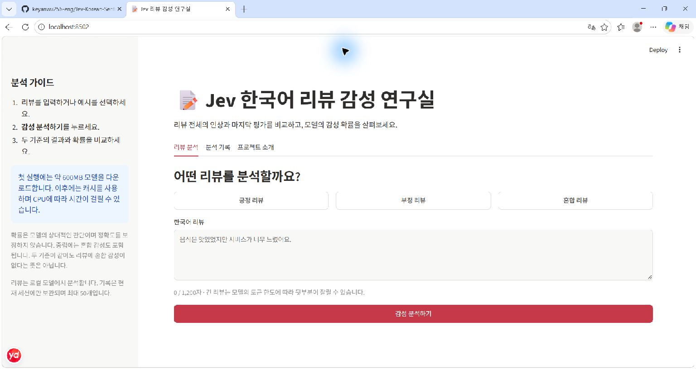

# Jev를 활용한 한국어 혼합 감성 리뷰 분석

**작성자: 오가암**

한국어 리뷰에 긍정과 부정이 함께 있을 때 전체 감성과 마지막 문장의 평가를 비교하는 프로젝트입니다. **한국어 지원 감성 모델이 주 분석**, **커뮤니티 OpenJevX가 대조 분석**을 담당합니다. 두 모델 모두 원문을 로컬 CPU에서 처리하며 번역이나 공식 Jev API를 사용하지 않습니다. Jev만으로 주 결과를 얻었다고 주장하지 않습니다.

> **한국어 분석 개선 완료:** 명확한 한국어 테스트 18개에서 새 주 모델 18/18, OpenJevX 8/18이었습니다. 작은 자가 작성 테스트이며 서비스 정확도 100%를 뜻하지 않습니다. 오류 제보 문장·혼합 사례도 별도로 기록했습니다. [변경 내용과 한계](KOREAN_IMPROVEMENT.md), [실제 비교 출력](evidence/korean_comparison.json)

**결과 해석:** 화면은 전체 원문 분류, 문장 감정 구성, 마지막 문장 평가를 구분합니다. 모델의 `neutral`은 중립·균형 범주이며 혼합 감정으로 자동 치환하지 않습니다. 문장별 확신 있는 긍정과 부정이 모두 있을 때만 별도로 공존을 표시합니다. OpenJevX에도 같은 불확실성 규칙을 적용하며 원시 라벨·확률은 보존합니다.

**실제 오분류 사례:** 사용 중 발견한 반어 배송 리뷰, 의류 혼합 리뷰, 숙소 재방문 거절 사례를 [ERROR_CASES.md](ERROR_CASES.md)에 정리했습니다. 높은 확률의 오분류와 부분 실패를 구분했으며, 18개 쉬운 예시의 성공을 일반 성능으로 확대하지 않습니다. [스크린샷 표시값 전사](evidence/error_cases.json)는 새 추론이나 원본 JSON이 아닙니다.

> **실행 환경:** 기존 Conda 환경의 DLL 문제는 프로젝트 전용 `.venv` 설치로 해결했습니다. 최신 주 모델·대조 분석·기록·오류 처리는 실제 모델로 검증했습니다. [현재 검증](evidence/verification.json), [과거 OpenJevX 검증](evidence/openjevx_verification_legacy.json), [보고서](REPORT.md)

## 구현 기능

- 긍정·부정·혼합 예시 리뷰 및 직접 입력
- 전체 감성 / 마지막 문장 별도 분석, 문장별 결과와 후보별 확률
- 낮은 확률·작은 확률 차이는 “판단 불확실”로 표시, 원시 라벨 보존
- 주 모델과 OpenJevX의 결과를 별도 표시·저장
- 낮은 확률과 입력 변경에 대한 안내
- 현재 세션 내 최근 50개 분석 기록과 기록 삭제
- 단일 결과 JSON, 전체 기록 CSV 다운로드
- 공개 모델 캐시 재사용 및 한국어 사용 안내



이 스크린샷은 개선 전 실제 첫 화면입니다. 최신 화면 및 성능 증거로 재사용하지 않습니다.

## 실행

Windows에서는 처음 한 번 `Setup_Jev.bat`를 실행하고 설치 완료 후 `Start_Jev.bat`를 더블 클릭합니다. 이 개발 PC에는 설치가 완료되어 바로 시작할 수 있습니다. Python 3.11에서 수동 설치하려면:

```bash
python -m venv .venv
.venv\Scripts\python.exe -m pip install -r requirements-lock.txt
.venv\Scripts\python.exe -m streamlit run app.py
```

브라우저에서 `http://localhost:8501`을 엽니다. 사용 중에는 시작 창을 열어 두세요. `CONNECTING`이면 시작 파일로 서버를 실행하고 새로고침하세요. 주 모델은 최초 약 300MB, OpenJevX는 별도 약 600MB이며 HF_TOKEN은 필수가 아닙니다. [자세한 실행 안내](RUNNING.md)

## 실험 결과와 해석

다음은 **기존 Notebook에 저장된 10개 리뷰 실험 결과**입니다. 오늘 모델을 다시 실행한 수치가 아닙니다.

| 지표 | 저장된 결과 | 의미 |
|---|---:|---|
| 전체 감성 / 마지막 평가 일치 | 6 / 10 (60%) | 두 질문의 출력이 같은 비율. 정확도가 아님 |
| 전체 감성의 참고 정답 일치 | 4 / 10 (40%) | Notebook 작성자가 정한 전체 감성 기준과 비교 |
| 마지막 평가의 동일 참고 정답 일치 | 3 / 10 (30%) | 마지막 평가 전용 정답이 아닌 동일 전체 감성 정답과 비교 |
| 상세 지시문 적용 후 참고 정답 일치 | 2 / 10 (20%) | 지시문을 길게 쓰는 것만으로 개선되지 않음 |
| 영어 번역문 전체 감성의 참고 정답 일치 | 7 / 10 (70%) | 동일한 소규모 예시에서 관찰된 결과 |

표본이 10개이고 참고 정답이 주관적이므로 일반적인 성능으로 확대 해석할 수 없습니다. 번역 과정과 질문 차이도 결과에 영향을 줄 수 있습니다. 현재 웹 앱의 전체 감성 질문은 Notebook과 문구가 다르므로 위 수치를 웹 앱의 정확도로 표시하지 않습니다.

## 보고서와 증거

| 파일 | 내용 |
|---|---|
| [REPORT.md](REPORT.md) | 문제 정의, 구현, 문제 해결, 실험 해석, 한계, 평가 기준 대응 |
| [evidence/README.md](evidence/README.md) | 증거 출처 및 검증 상태 안내 |
| [기존 결과 JSON](evidence/notebook_recorded_results.json) | Notebook의 실제 저장 출력과 참고 정답 |
| [10개 리뷰 비교표](evidence/notebook_results.md) | 원문과 각 분류 결과를 나란히 정리 |
| [검증 기록](evidence/verification.json) | 2026-11-17 실제 통과 / 차단된 검사 |
| [verify_project.py](verify_project.py) | 저장 결과 교차 확인 및 현재 앱 재검증 스크립트 |
| `Jev_한국어_혼합감성_프로젝트_최종.ipynb` | 기존 실험·튜토리얼 원본. 저장 출력 보존 |

저장소 폴더에서 `python verify_project.py`를 실행하면 현재 두 모델의 기능 테스트와 18개 한국어 사례 평가를 수행하고 검증 기록을 저장합니다. `test_korean.py`는 기능 테스트, `evaluate_korean.py`는 비교 평가입니다. 기존 Notebook 출력은 별도로 보존하며 새 모델의 성능으로 간주하지 않습니다.

## 현재 앱 재검증 및 향후 개선

한국어 개선 전 OpenJevX만 사용한 10개 리뷰의 재검증에서는 판단 일치 6/10, 전체 참고 라벨 일치 6/10, 마지막 평가의 동일 전체 감성 참고 라벨 일치 3/10이었습니다. [기존 원본](evidence/current_app_results.json)과 기존 샘플 CSV/JSON은 과거 결과입니다. 최신 한국어 주 모델의 비교 결과는 `evidence/korean_comparison.json`을 참고하세요.

더 큰 독립 한국어 평가셋, 마지막 평가 전용 정답, 반어 및 도메인별 검증이 향후 개선 사항입니다. 문장 분리는 구두점·줄바꿈 규칙이므로 마지막 의미 절을 완벽히 추출하지는 못합니다.

원격 웹 서비스 배포는 수행하지 않았습니다. 모델 확률은 정확도를 보장하지 않으며 결과를 자동 의사결정에 사용하지 않습니다.
