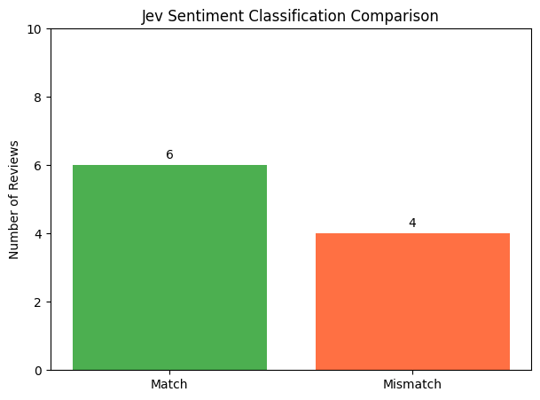
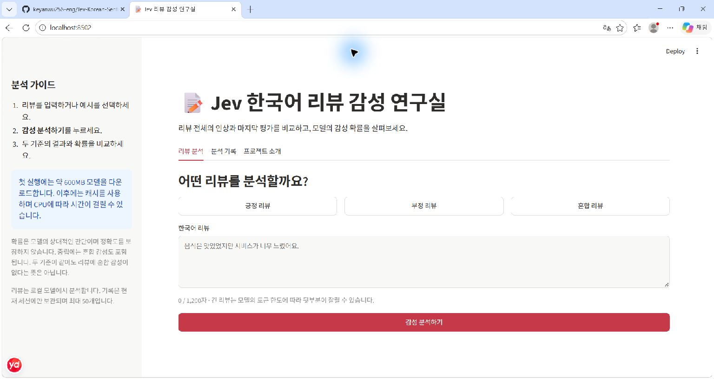

# 프로젝트 보고서

**주제:** Jev 방식의 한국어 혼합 감성 리뷰 분류 및 판단 기준 비교
**정리일:** 2026-11-17 (한국 시간)
**구현:** Python · Streamlit · OpenJevX · ONNX Runtime CPU

## 1. 문제 정의 및 활용성

고객 리뷰에는 “음식은 맛있었지만 서비스가 느렸다”처럼 긍정과 부정이 동시에 등장한다. 한 가지 라벨만 보면 전체 인상과 마지막 평가를 혼동할 수 있다. 이 프로젝트는 같은 리뷰를 두 질문으로 분류하고 각 후보의 확률을 함께 보여 주어, 판단 기준에 따라 결과가 어떻게 달라지는지 관찰한다.

활용 대상은 리뷰 분석을 학습하는 학생과 분류 결과를 검토하는 사용자이다. 실제 고객 대응을 자동화하는 서비스가 아니라, 분류 기준과 모델 한계를 이해하는 실험·시연 도구로 범위를 정했다.

## 2. 구현 방식과 범위

사용자 입력 → 모델 파일 캐시 확인 → 로컬 ONNX 모델 초기화 → `decide(review, QUESTIONS)` 호출 → 두 질문의 결과와 확률 표시 → 세션 기록 및 파일 내보내기 순서로 처리한다.

| 구성 | 동작 |
|---|---|
| 입력 | 한국어 직접 입력, 세 가지 예시 버튼, 빈 입력 차단, 1,200자 입력 제한 |
| 질문 | 전체적인 내용을 기준으로 한 감성 / 마지막 평가를 중심으로 한 감성 |
| 후보 | positive, negative, neutral. 웹 화면의 neutral은 중립 / 혼합으로 표시 |
| 결과 | 두 분류 카드, 후보별 확률 막대, 판단 일치 여부, 낮은 확률 안내 |
| 기록 | 세션당 최근 50개, 최신 결과 유지, 입력 변경 시 이전 결과임을 안내 |
| 내보내기 | JSON 단일 결과, UTF-8 BOM CSV 전체 기록, 기록 삭제 |
| 모델 파일 | 특정 리비전에 고정하고 캐시를 먼저 확인. 캐시가 없을 때 다운로드 |

마지막 평가는 입력을 별도로 분할한 결과가 아니라 모델에 전달한 질문이다. 긴 입력은 모델 토큰 한도 때문에 뒤쪽 내용이 잘릴 수 있다. 기록은 영구 데이터베이스가 아니며 세션 종료 시 사라질 수 있다.

사용한 것은 커뮤니티 OpenJevX 모델이다. 공식 Jev API와 호환되는 유형의 판단 구조를 실습한 것이며 공식 API 성능을 측정한 것은 아니다. Notebook에는 입문 튜토리얼 내용이 함께 있으며, 본 프로젝트의 기여는 한국어 리뷰 실험, 기준 비교, 오류 관찰 및 Streamlit 화면 구현이다.

## 3. 문제 해결 과정과 고민

### 3.1 인증 경고와 실제 오류 구분

처음에는 Streamlit 서버 시작 뒤 Hugging Face의 비인증 요청 경고가 보였다. 서버 시작 메시지와 경고만으로 앱 실패 원인을 확정하지 않고, 모델 캐시·직접 추론·브라우저 오류를 구분해 조사했다. 공개 모델이므로 인증 토큰이 반드시 필요한 상황은 아니었다. 코드에 토큰을 넣지 않고 캐시를 우선 사용하도록 변경했다.

### 3.2 결과 출력에서 발생한 DLL 차단

11월 12일에는 `conversion`을 가져오는 중 애플리케이션 제어 정책이 차단했다. Windows Code Integrity 로그에서 pandas의 `conversion.cp311-win_amd64.pyd`와 pyarrow의 DLL 차단을 확인했다. 모델 자체는 당시 직접 호출 테스트에서 한국어 입력에 대한 결과를 반환했다.

기존 `st.write(result)`의 객체 출력 대신 `st.json(result)`를 사용해 해당 결과 표시 과정에서 불필요한 데이터프레임 의존성을 피했다. 오류는 화면에 상세 표시하고 로그에도 남기도록 변경했다. 당시 개발 세션에서는 분석과 기록·삭제 테스트가 통과했지만 그 세션의 출력 파일이나 성공 화면이 별도로 저장되지 않았으므로 이번 증거 목록에 새 성공 자료처럼 포함하지 않았다.

### 3.3 11월 17일의 별도 환경 문제

보고서 작성 중 실제 재검증에서 NumPy의 `_multiarray_umath` 로딩이 차단됐다. 샌드박스 밖 실행도 동일하게 실패했다. Windows Code Integrity 이벤트 3077에서는 Conda 환경의 `Library/bin/libcblas.dll` 차단도 확인했다. 이는 앞서 수정한 결과 출력 문제와 별개이며 `st.json()`으로 모델의 필수 NumPy 의존성을 제거할 수 없다.

보안 정책을 끄거나 우회하지 않았다. 현재 상태를 `BLOCKED_MODEL_LOAD`로 남겼고, 모델 결과를 모의로 만들어 성공 증거로 제시하지 않았다. 정책상 허용되는 패키지 환경을 확보하고 다시 검증하는 것이 남은 작업이다.

## 4. 기존 Notebook 실험과 결과

Notebook에 저장된 10개 한국어 리뷰를 확인하고 셀 출력의 사전형 결과를 직접 읽어 다시 집계했다. 아래는 기존 저장 결과이며 11월 17일 재추론 결과가 아니다. 원문·예측·참고 정답은 [전체 비교표](evidence/notebook_results.md), 원본 질문은 [JSON](evidence/notebook_recorded_results.json)에 있다.

| 비교 | 결과 |
|---|---:|
| 전체 / 마지막 판단 일치 | 6 / 10, 60% |
| 전체 / 마지막 판단 불일치 | 4 / 10, 40% |
| 전체 감성과 Notebook 참고 정답 일치 | 4 / 10, 40% |
| 마지막 평가와 동일 전체 감성 참고 정답 일치 | 3 / 10, 30% |
| 상세 지시문 조건과 참고 정답 일치 | 2 / 10, 20% |
| 영어 번역문 전체 감성과 참고 정답 일치 | 7 / 10, 70% |

위 그림은 Notebook 저장 PNG를 그대로 추출한 것이다. 새로 그린 결과나 현재 웹 앱 실행 결과가 아니다.

### 결과 해석

- 배송이 빠르지만 제품이 파손됐다는 리뷰는 전체 감성에서 부정, 마지막 평가에서는 긍정으로 저장됐다. 기준이 바뀌면 답이 달라질 수 있음을 보여 주지만, 마지막 평가를 올바르게 이해했다는 증거는 아니다.
- 명확한 긍정 리뷰가 중립으로 분류되는 사례와 부정 리뷰가 중립으로 분류되는 사례도 있다. 프로그램이 정상 작동하는 것과 분류 품질은 별개다.
- 지시문을 자세히 작성한 실험은 40%에서 20%로 감소했다. 이 표본에서는 프롬프트 확장이 개선을 보장하지 않았다.
- 영어 번역문은 이 표본에서 70%였지만, 표본이 작고 번역·주관적 정답·질문 조건이 얽혀 있어 한국어 전체 성능이나 번역의 인과 효과로 일반화할 수 없다.
- 마지막 평가 조건도 전체 감성의 참고 정답과 비교했으므로 30%를 마지막 평가 전용 태스크 정확도로 해석하면 안 된다. 별도의 마지막 평가 정답이 필요하다.

웹 앱과 Notebook은 전체 감성 질문 문구가 다르다. 따라서 Notebook의 수치를 웹 앱의 성능 수치로 재사용하지 않았다. 참고 정답은 Notebook에 들어 있던 작성자의 기준이며 독립된 다수 평가자의 검증 정답이 아니다.

## 5. 실행 검증과 증거

검증 대상 코드의 SHA-256, 패키지 버전, 시각은 [verification.json](evidence/verification.json)에 기록했다. 실제 모델 로딩을 시도했으며 실패 시 모의 모델로 대체하지 않았다.

| 검사 | 2026-11-17 결과 |
|---|---|
| 초기 페이지 렌더링 | 통과 — 실제 브라우저 화면과 AppTest 확인 |
| 빈 리뷰 분석 | 통과 — 경고, 기록 추가 없음 |
| 혼합 예시 선택 | 통과 — 입력값 갱신 확인 |
| 모델 실패 처리 | 통과 — 오류 표시, 허위 결과·기록 생성 없음 |
| 현재 모델 추론 | 차단 — NumPy/BLAS DLL 정책 문제 |
| 실제 확률 결과·기록·다운로드 전체 흐름 | 이번 재검증 미완료 — 모델 로딩에 의존 |

원본 Notebook은 저장 상태를 보존했다. 일부 셀은 앞서 생성된 `df` 변수에 의존하므로 깨끗한 커널에서 전체 실행된 결과라고 주장하지 않는다. 별도 검증 스크립트는 필요한 상수와 저장 결과를 추출하고 현재 웹 앱을 검증해 이 실행 순서 의존성을 줄인다.

## 6. 평가 기준 대응

| 평가 기준 | 대응 내용 | 증거 |
|---|---|---|
| 문제 해결 과정 및 고민 | 경고 / 모델 / 출력 오류 분리, DLL 원인 확인, 캐시·JSON 개선, 새 실패 공개 | 본 보고서 3장, 오류 로그 |
| 기능 구현 및 동작 | 입력·두 기준·확률·기록·내보내기 구현. 현재 모델 환경 차단은 미해결로 명시 | app.py, 첫 화면, verification.json |
| 문제 정의 및 활용성 | 한국어 혼합 리뷰에서 판단 기준 차이를 관찰하는 도구 | 1장, 비교표 |
| 결과물 설명 및 가독성 | 실행 방법, 출처, 수치 해석, 한계, 재검증 스크립트 제공 | README, RUNNING, evidence 목록 |

이 표는 자기 점수나 만점 보장이 아니다. 현재 추론 실행이 차단된 점은 기능 동작 평가 전에 해결해야 한다.

## 7. 결론과 남은 작업

같은 리뷰도 질문 기준에 따라 출력이 달라졌고, 설명을 자세히 적는 것만으로 한국어 분류가 개선되지는 않았다. 감성 확률을 함께 보여 주고 오류 사례를 검토하는 과정이 필요하다. 실험을 조작하기보다 낮은 성능과 환경 오류를 명시한 것이 본 프로젝트의 주요 학습 결과다.

기능과 보고서 자료는 구성했지만 **현재 PC의 추론 재검증은 미완료**다. 허용된 실행 환경을 확보한 뒤 `python verify_project.py`를 다시 실행하고, 성공 결과 화면과 실제 CSV/JSON을 추가해야 시연 준비를 마칠 수 있다. 그 이후에는 별도의 마지막 평가 정답 구축과 더 큰 리뷰 표본 평가가 개선 과제다.

## 8. AI 도구 사용 및 참고 자료

개발 중 Codex를 이용해 Python 코드 수정, 오류 진단, 테스트 스크립트 및 보고서 정리를 보조받았다. 모델 출력과 기존 Notebook 저장 결과를 대조해 문서화했으며, 이 보고서는 AI 보조로 정리한 자료다. 제출 전 작성자가 내용을 검토하고 설명할 수 있어야 한다.

- 기존 Notebook의 입문 튜토리얼 및 저장된 프로젝트 실험 셀
- [OpenJevX 모델 저장소](https://huggingface.co/muthuishere/openjevx)
- [기존 Notebook에 명시된 Jev 학습 자료](https://wikidocs.net/432834)
- 평가 기준: 수업에서 제공한 프로젝트 1의 네 가지 항목(각 5점)
